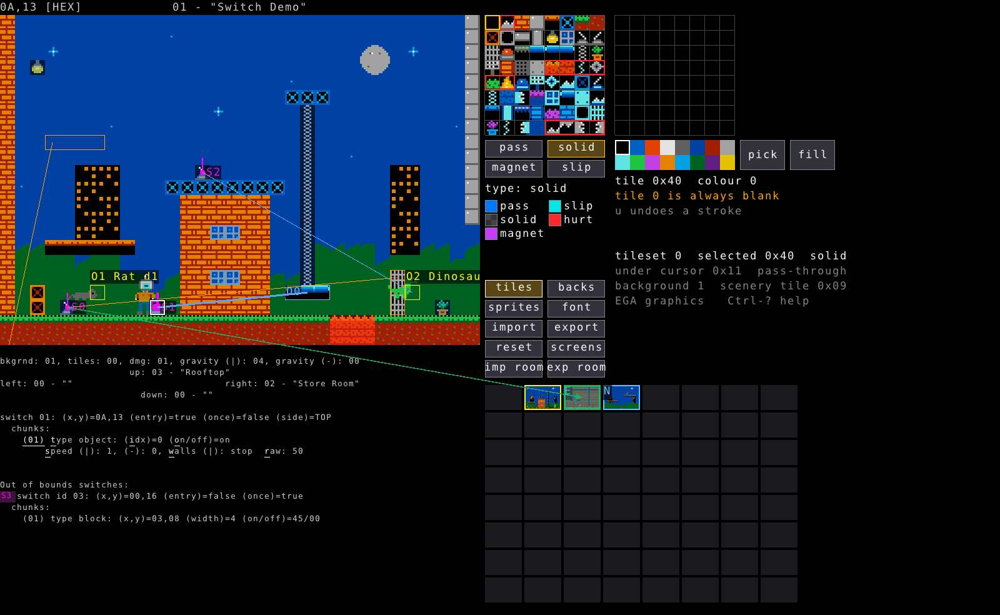
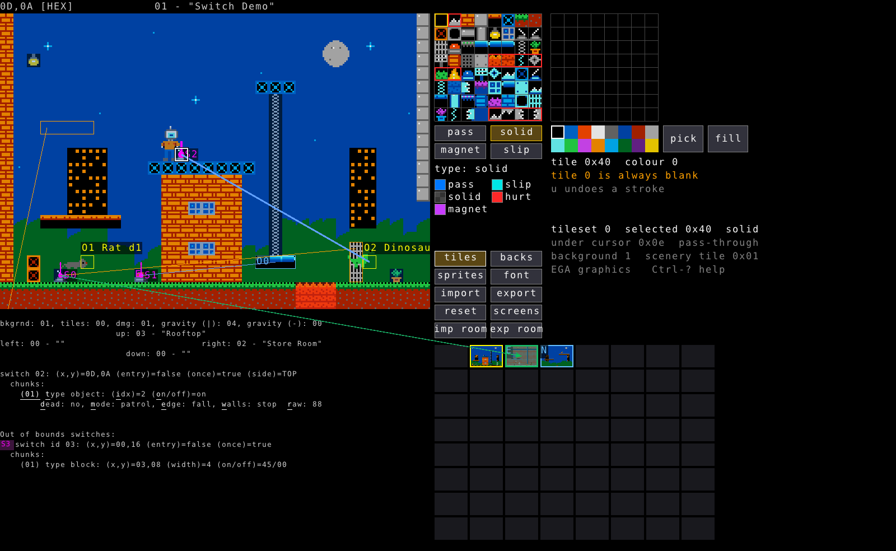

# The switch system

A switch is a trigger (a button, a web target, a room-entry sensor) plus a
list of **chunks** - commands that fire when the switch turns on or off.
This is how every interactive thing in a room happens: doors, moving
platforms, enemies that wake up, one switch arming another one across the
level. This doc covers the format field-by-field and how to build it in
both editors; see [USAGE.md](USAGE.md) for the editors' general keys.

A room holds up to 16 switches; each switch holds up to 16 chunks, the
first of which is always its **preamble** (the switch itself - position,
trigger type, side) followed by up to 15 real chunks.

## The preamble

```
switch 04: (x,y)=10,14 (entry)=true (once)=false (side)=BOTTOM
```

| Field | Meaning |
|---|---|
| `(x,y)` | The switch's tile |
| `entry` | What kind of trigger this is - see below |
| `once` | Whether the switch stays armed after its first trigger |
| `side` | Which side of the tile the trigger faces |

**`entry`** is genuinely two different mechanisms depending on the tile
underneath (verified in DOSBox):

- `entry=true` on a **pass-through** tile (0x00-0x3f): a **proximity
  sensor** - fires when Spider-Man *or a moving object* touches it. Not a
  button, not webbable.
- `entry=true` on **any other tile** (solid/magnetic/slippery): fires on
  **every room entry**, from any edge, Spider-Man anywhere in the room -
  `side` is irrelevant and it isn't webbable either.
- `entry=false`, `side=TOP`: a **pressure plate** - standing on it fires it.
  This is how the game's roof and floor buttons work.
- `entry=false`, `side=LEFT`/`RIGHT`/`BOTTOM`: a **web button** - needs a
  web thrown from that side (short reach, ~3 tiles; stand adjacent, don't
  rely on a web reaching around a corner).

The GUI draws a small arrow off the switch marker toward `side`, and an
"E" in the tile's corner when `entry` is set, so you can tell which kind
of trigger you're looking at without opening it.

**`once`** decides what happens on the *second* trigger:

- `once=true`: stays active. Its chunks fire again on every later visit to
  the room (a pre-activated sensor or web button re-runs its object
  commands and redraws its blocks every time you walk in) - this is how a
  helicopter that's already risen stays risen when you leave and come back.
- `once=false`: flips state on every trigger - active, then idle, then
  active again. Blocks revert on the second trigger; object commands only
  run on the transition to *active*.

A common pattern: end a repeatable trigger's own chunk list with a
`TOGGLE_BIT` chunk that re-arms itself (writes "turn off" to its own
switch), and keep any state you actually want to persist on a separate,
off-grid (`once=true`) switch instead.

## Chunk types

Every chunk after the preamble is one of three types. `t` cycles a chunk's
type (skipping `TOGGLE_OBJECT` if the room has no objects to target);
`+`/`-` reorder a switch's chunk list.

### `type block` - TOGGLE_BLOCK

```
(01) type block: (x,y)=0F,04 (width)=2 (on/off)=00/C6
```

Covers a run of `width` (or `height`, if vertical - `Space` toggles the
axis) tiles starting at `(x,y)`, and swaps every tile in that run between
two values:

- **off** - shown while the switch is idle. This is what the room looks
  like on entry.
- **on** - shown while the switch is active.

(The struct fields are named for what they mean, not disk order - if you
ever see raw bytes elsewhere, don't assume "on" is byte 1.)


Editing (`Ctrl-s` on the switch, then select the chunk):

| Key | Action |
|---|---|
| `Space` | Toggle horizontal/vertical |
| `hjkl` / arrows | Move it |
| `Alt`+dir | Resize |
| `o` | Toggle switch-on preview - while armed, typed hex digits set the **on** tile (and the room map/GUI picture show it live); while off, they set **off** |
| hex digits | Set whichever of on/off is currently armed |

The `Ctrl-D t` tile-class tint (see [USAGE.md](USAGE.md)) always tints
whichever tile the chunk is *currently showing* - the idle one normally,
the active one while you have it armed with `o`.

#### The "memory" variant - rewriting an exit

A `TOGGLE_BLOCK` chunk whose position falls *past* the 32x22 tilemap (not
a real tile at all) doesn't draw anything - it's a **memory cell**,
almost always used to flip which room an exit leads to. Specifically, a
chunk at tile-row 22 (just past the bottom of the map), column `x`,
rewrites the room's own exit byte: `x=2` is the up exit, `3` right, `4`
down, `5` left. Its "on"/"off" values are then two different room ids for
that exit, and the switch decides which one is currently wired up. The GUI
draws this as orange arrows from the switch to its off/on target rooms on
the world map, and the reverse (which switch controls an exit *into* the
room you're looking at) as an orange arrow the other way, labelled e.g.
"east on -> here".

### `type toggle` - TOGGLE_BIT

```
switch 00: (x,y)=17,4 (entry)=false (once)=true (side)=TOP
  chunks:
    (01) type toggle: (room) After Midnight (switch) 1
        (on)=turn on (off)=turn off
```


Targets **another switch**, anywhere in the level (`(room)`/`(switch)`),
and applies one of four effects to it - independently for when *this*
switch turns on and when it turns off:

| Value | Effect on the target |
|---|---|
| `noop` | Nothing |
| `turn on` | Activates the target |
| `turn off` | Idles the target |
| `toggle` | Flips whatever the target's current state is |

This is how one switch arms or chains into another - a button that both
opens a door (its own `TOGGLE_BLOCK`) *and* arms a second switch
elsewhere, or a self-re-arming repeatable trigger (a chunk that writes
`turn off` back to its own switch).

Editing:

| Key | Action |
|---|---|
| `r` | Change the target room |
| `s` | Cycle through the target room's actual switches (never points at nothing) |
| `n` | Cycle the **on** value: noop / turn on / turn off / toggle |
| `f` | Cycle the **off** value, same four options |

(`n`/`f` - the second letter of "o**n**" and "o**ff**", since both words
start with the same letter.)

### `type object` - TOGGLE_OBJECT

```
switch 04: (x,y)=10,14 (entry)=true (once)=false (side)=BOTTOM
  chunks:
    (01) type object: (idx)=0 (on/off)=on
        speed (|): 2, (-): 0, walls (|): stop  raw: 60
```



Targets an **object** in the room (`idx`, bounded to the room's actual
object list) and sends it a one-byte runtime command (`raw`) when
triggered. `(on/off)` decides *when* it fires - `on` fires it when this
switch activates, `off` when it idles (only these two values are ever
actually used; `i` cycles `idx`, `o` toggles this).

The command byte means something different depending on whether `idx`
names a **block** or a **sprite** - the editor shows and edits the right
one automatically:

**Block** - two independent axes, each a signed speed and (if moving) a
wall behaviour:

| Field | Meaning |
|---|---|
| `speed (\|)` | Vertical speed, -3..3 (negative = down) |
| `speed (-)` | Horizontal speed, -3..3 (negative = left) |
| `walls` | `back` (bounces) or `stop`, shown per axis only while that axis is moving |

Editing: `s`/`d`/`w` arm speed/direction/walls focus, then `hjkl`/arrows
(or `\|`/`-`, matching the room-detail "gravity `(\|)`" convention) adjust
it; pressing a direction at speed 0 sets that direction and jumps to speed
1, the same direction again ratchets the speed up, the opposite direction
ratchets it back down through 0. If only one axis is currently moving, `w`
toggles that axis's wall bit directly instead of making you disambiguate.

**Sprite** - the same attributes MOVERTAB.DAT sets at room load, minus
flip (a switch command can't flip a sprite in the real game - only room
load can):



| Field | Meaning |
|---|---|
| `dead` | Whether the sprite is alive at all |
| `mode` | `stopped` / `patrol` (walks until it hits something, turns) / `chase` (comes after Spider-Man) |
| `stopped` | Chase mode's own currently-moving flag (only shown while chasing) |
| `edge` | `turn` or `fall` off an edge (patrol/chase only) |
| `walls` | `turn` or `stop` at a wall (patrol/chase only) |

Editing: `d` toggles dead/alive, `m`/`M` cycles the mode forward/back, `s`
toggles chase's stopped flag, `w`/`e` directly toggle wall/edge. A byte
this picker would never produce itself (e.g. from raw hex entry, or an
older tool) shows as `GLITCHY` until you press `d`/`m` to normalise it.

**Raw entry**: `r` toggles a raw two-hex-digit entry mode for the whole
byte, gated behind that key specifically so hex digits (`d`, `e`, `f`, ...)
don't get swallowed as tile bytes instead of reaching the attribute keys
above.

## Editing switches in the TUI

`Ctrl-s` on the switch's tile opens it. With exactly one real chunk, that
chunk opens directly; with more, `c` (if there are exactly two) or a
digit picks which one. `+` adds a new chunk (defaults to `TOGGLE_BLOCK`);
`x`/`Delete` cuts one. `Escape` (or `Enter`, which is a full alias for it
here) backs out one layer at a time - closes help, then drops whatever
key is "armed" (e.g. `TOGGLE_OBJECT`'s `s`/`d`/`w` focus), then finally
leaves switch editing.

## Editing in the GUI

Everything above works identically by keyboard. The GUI adds:

- **Right-click an object**, with a switch open, to add a `TOGGLE_OBJECT`
  chunk linked to it.
- **Right-click another switch** to add a `TOGGLE_BIT` chunk to it.
- **Right-drag a run of tiles** to add a `TOGGLE_BLOCK` chunk covering
  them.
- **Click a coloured link line** (drawn from the switch to whatever its
  chunks target) to select that chunk; click it again to jump to the
  target itself (the object, the first tile of a block run, or the other
  room's switch); click again to go back. Works from either end - a
  cross-room `TOGGLE_BIT` draws its arrow on the *world map*, both ways
  (green from the source switch to the target room's thumbnail, violet
  the other way from a switch that targets one *here*).
- **Click a line in the info panel** below the picture - "switch NN",
  "(NN) type ...", "sprite N"/"block N" - to open that switch, chunk, or
  object directly, same as `Ctrl-s`/a digit/`Ctrl-o` would.

Overlay colours (from the `Ctrl-?` help, also reproduced in full below):
magenta switch markers, orange `TOGGLE_BLOCK` links, light blue
`TOGGLE_OBJECT` links, green `TOGGLE_BIT` links (violet the reverse
direction), yellow for the current room/goto emphasis, gold for keyboard
focus.


## Out-of-bounds switches

A switch whose preamble tile is off the visible 32x22 grid (`y >= 22`, a
common convention is `(0, 31)`) is never drawn on the map at all - it
exists purely to *hold* chunks, usually a persistent `once=true` flag
(re-armed by another switch's `TOGGLE_BIT`) or a pure `TOGGLE_OBJECT`
target with nothing to press. Both editors pin an "Out of bounds
switches" list at the bottom of the panel for exactly these; the GUI
labels them `S0`-`S9`, then `SA`-`SF` for indices 10-15 - matching the
single hex-digit key (`s` then that digit) that actually gets you there,
rather than a two-digit number that would look like it needs two
keystrokes.

## Common patterns

**A door with a button.** A `TOGGLE_BLOCK` chunk on the door's tiles
(solid tile as `off`, an open/pass-through tile as `on`) on a switch with
`entry=false` and the `side` matching how the player reaches the button.
Decide `once` based on whether the door should stay open forever
(`true`) or need re-pressing (`false`).

**A moving platform.** A block object with a MOVERTAB entry set to some
speed (`Enter` on it) so it's already moving at room load, `walls: back`
if it should bounce off walls on its own - reversing direction at a wall
is a MOVERTAB-only property, never a runtime switch command. A switch's
`TOGGLE_OBJECT` chunk can then *change* its speed/direction/walls (or stop
it, or send it the other way) when triggered.

**A one-shot trap.** `once=false` on the trigger, so its chunks only fire
on the transition to active, then idle again on the second trigger and
never re-fire unless something else flips it back with a `TOGGLE_BIT`.

**A switch that needs a room-entry replay.** Remember that *every active
switch replays all its chunks on room entry* - a pre-armed `once=true`
sensor re-issues its object commands and redraws its blocks every time you
walk into the room, which is exactly how a raised platform or an already-
opened door stays that way across visits without needing its own special
case.
