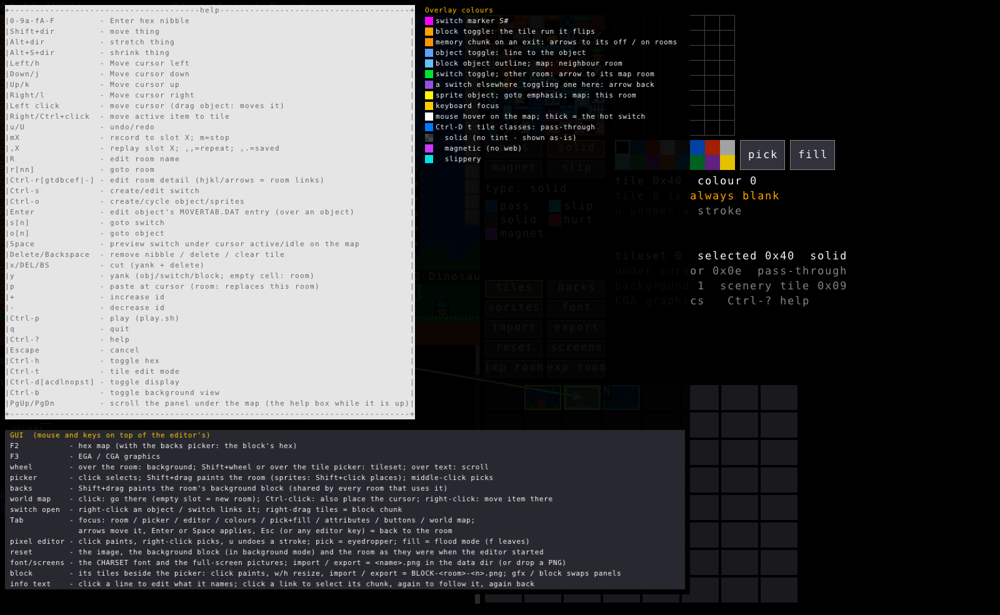
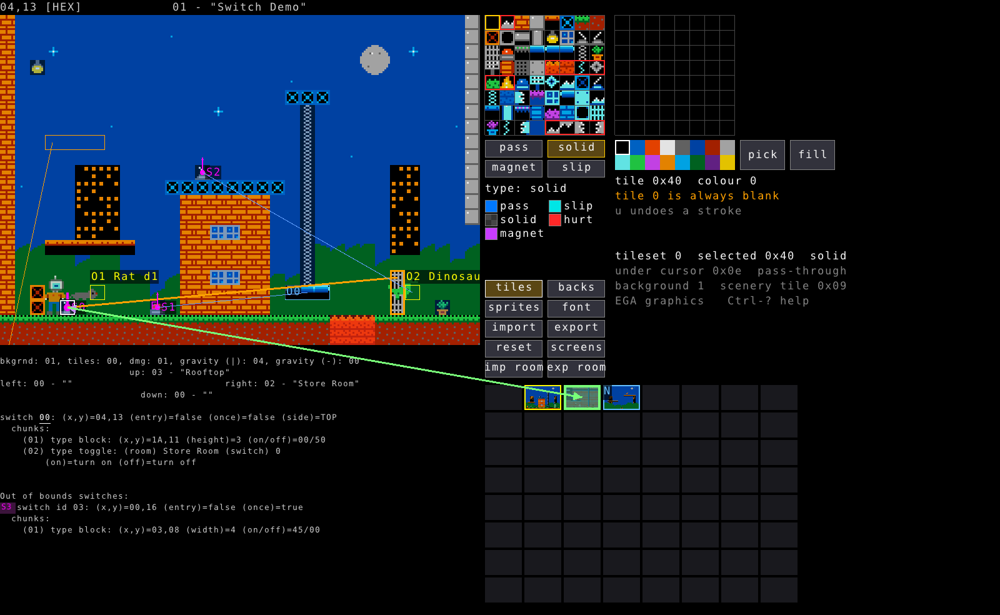
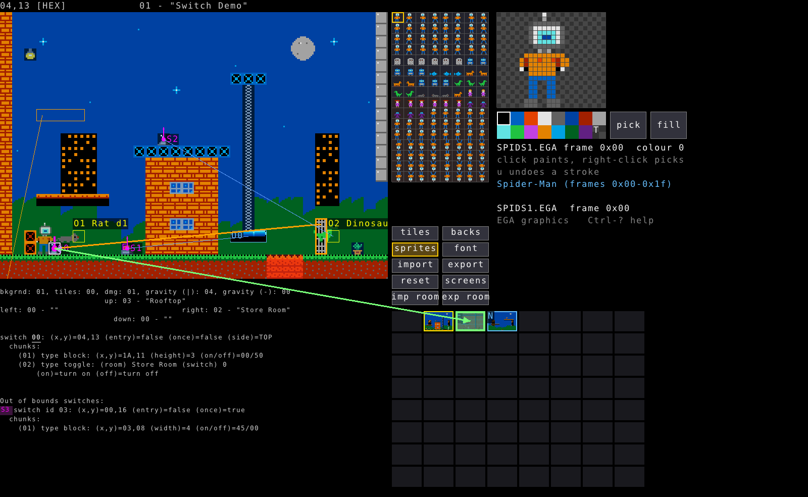
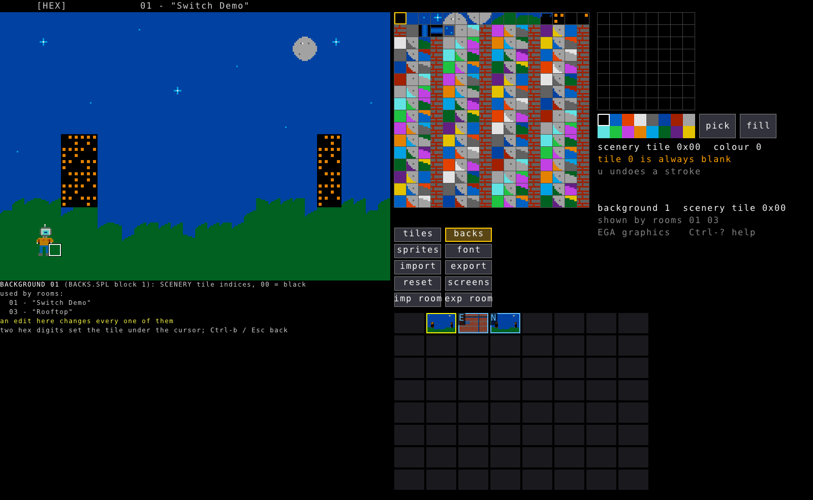
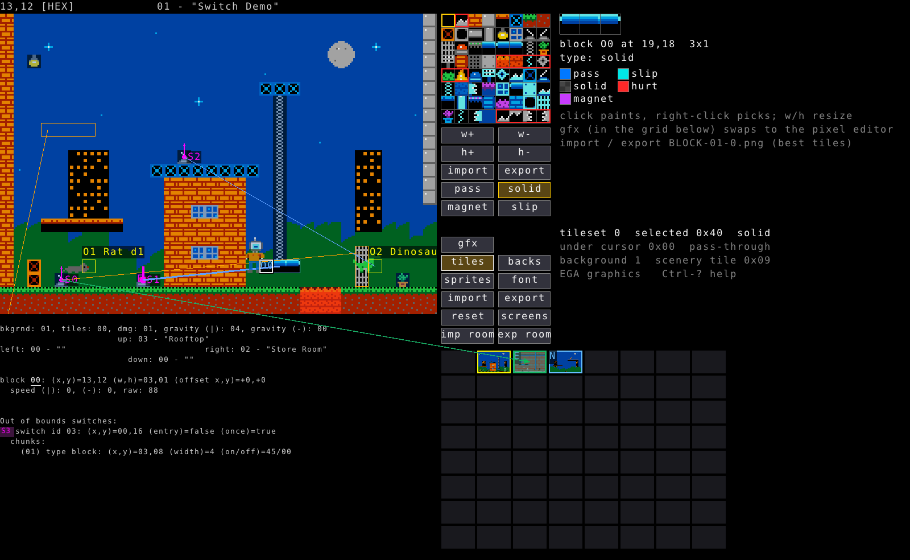

# Using spidey-editor

spidey-editor edits `ROOMS.SPL`, the room/level format used by *The Amazing
Spider-Man* (1990, Paragon Software, DOS). A `ROOMS.SPL` holds up to 64 rooms:
each room is a 32x22 tile map, a list of objects (sprites and movable
blocks), a list of switches (see [SWITCHES.md](SWITCHES.md) for the switch
system in depth), and some metadata (background, gravity, room links, name).

There are three ways to work with a `ROOMS.SPL`:

- **`./a.out tui`** - an interactive terminal (TUI) editor.
- **`./a.out gui`** - a graphical (raylib) editor with a picture of the room,
  mouse support, and pixel/sprite/background editors. It runs the *same*
  underlying editor as the TUI (same keys, same state machine) with a
  picture and mouse on top.
- **`./a.out <subcommand>`** - a scriptable CLI ("the patch program") for
  bulk inspection and editing: listing rooms, dumping/importing a whole file
  as text, patching raw bytes, deleting things, swapping rooms, rendering
  PNGs.

`./a.out editor` opens the GUI when there is a display (`DISPLAY` or
`WAYLAND_DISPLAY` set) and the TUI otherwise.

All of them read `ROOMS.SPL` (and `MOVERTAB.DAT`, `BACKS.SPL`, the graphics)
from one data directory: the current directory, or the one given with
`--data-dir DIR` anywhere on the command line. Writes go there too, unless a
command is given an `OUT.SPL` to write instead.

## Building

```sh
make          # ./a.out, ASAN + debug. editor.so / gui.so are built on first
              # use and hot-reload while a.out runs (edit a .c file, save,
              # and a running ./a.out editor or ./a.out gui picks it up)
make release  # ./spidey-editor: one static binary, no hot reload, -O2
make check    # round-trip tests for the .SPL codec and the background store
```

`make check`, `python3 tui_smoke_test.py` and `./gui_smoke_test.sh` need none
of the game's files: they run on the demo data set `docs/demo/gen_demo.py`
generates, in scratch directories.

`make` needs nothing beyond a C compiler; raylib 6.0 is vendored in
`raylib-6.0_linux_amd64/`.

---

## The CLI ("patch program")

```sh
./a.out help
```

```
Options (any position):
    --data-dir DIR                       - Directory holding ROOMS.SPL, MOVERTAB.DAT, BACKS.SPL and the graphics (default: the working directory)
Subcommands:
    rooms                                - List rooms
    display [ROOMID]                     - Defaults to all rooms
    import [FILE|-] [OUT.SPL]             - Import display output (rooms not in file blanked); writes OUT.SPL (default ROOMS.SPL)
    importRoom ROOMID [FILE|-] [OUT.SPL]  - Import one room at ROOMID; writes OUT.SPL (default ROOMS.SPL)
    recompress                           - No changes to underlying data, just recompress
    swap A B [--movertab FILE]           - Exchange rooms A and B (links, bases, toggle bits follow); permutes FILE or the data dir's MOVERTAB.DAT into OUT's MOVERTAB.DAT
    patch ROOMID ADDR VAL [ADDR VAL]...  - Patch room by changing the bytes requested. For multiple rooms provide patch command again
    delete ROOM_ID thing...              - Delete switch/chunk/object from room
    find_tile TILE [OFFSET]              - Find a tile/offset pair
    find_sprite SPRITENAME               - Find a sprite
    render ROOMID|all|montage OUT|DIR    - Render room(s) to PNG (--debug --scale N --movertab FILE)
    editor [--scale N]                   - The GUI when a display is available (DISPLAY / WAYLAND_DISPLAY), else the text-mode editor
    gui [--scale N]                      - raylib GUI editor (terminal-editor keys)
    tui                                  - Text-mode editor
      (SPIDEY_NO_HOTRELOAD=1 turns off source watching in the debug build; `make release` has none)
    help                                 - Display this message
```

### `rooms` - a one-line-per-room listing

```sh
./a.out rooms
```

Lists every valid room's id and name. Good for a quick "what's in this file"
check before diving in with `display` or the editors.

### `display` - dump rooms as text

```sh
./a.out display          # every room
./a.out display 1        # just room 1
```

Prints the tile map (as coloured hex, terminal permitting), the room's
metadata (background, gravity, damage, room links), and every object and
switch/chunk, in the same textual notation the editors use. This is also
the format `import`/`importRoom` read back in, so `display > rooms.txt`,
hand-edit `rooms.txt`, then `import rooms.txt` is a legitimate (if
old-fashioned) editing workflow - and the natural target for a script
that generates levels.

`display`'s per-object and per-chunk text is exactly what
[SWITCHES.md](SWITCHES.md) explains field-by-field, and exactly what you'll
see in the editors' info panels.

### `import` / `importRoom` - rebuild a file from `display`'s text

```sh
./a.out display > rooms.txt   # export
# ... edit rooms.txt by hand, or generate it ...
./a.out import rooms.txt ROOMS.SPL      # rebuild the whole file
./a.out importRoom 3 room3.txt ROOMS.SPL  # rebuild just room 3
```

`import` blanks any room *not* present in the input, so it's a full rebuild,
not a merge. Switch targets (`(room) NAME (switch) N`) resolve by room name,
so renaming a room and updating references in the same import works.

### `patch` - poke raw bytes

```sh
./a.out patch ROOM_ID ADDR VAL [ADDR VAL]...
```

Directly sets bytes in a room's decompressed representation at raw
addresses (tile offsets, object bytes, switch/chunk bytes, MOVERTAB-style
offsets - see `main.c`'s `PatchType` enum for the address spaces). This is
the lowest-level tool here, mostly useful for scripting a batch of small
changes (the levelset generators use it a little) or for probing the format
while reverse-engineering. For everyday editing, use the TUI or GUI - they
turn these same bytes into named fields you don't have to compute offsets
for by hand.

### `delete` - remove a switch/chunk/object by id

```sh
./a.out delete ROOM_ID switch[2]          # switch 2 and all its chunks
./a.out delete ROOM_ID switch[2].chunk[1] # just chunk 1 of switch 2
./a.out delete ROOM_ID object[0]          # object 0 (and any switch chunks that reference it break)
```

### `swap` - exchange two rooms

```sh
./a.out swap 1 5 --movertab MOVERTAB.DAT
```

Exchanges rooms A and B *in place*: room links (up/down/left/right) that
point at either room follow them, `TOGGLE_BIT` chunks that target a switch
in either room follow it, and the per-room object/switch index bases
(`UNKNOWN_c`/`UNKNOWN_f`) are recomputed. `--movertab` also permutes the
corresponding block of `MOVERTAB.DAT` so a room's objects keep their
initial movement/flip state after the swap. Without `--movertab`, it reads
and writes the data directory's `MOVERTAB.DAT` if present.

### `render` - room(s) to PNG

```sh
./a.out render 1 room1.png --data-dir Spider
./a.out render all out-dir/ --data-dir Spider
./a.out render montage montage.png --data-dir Spider --scale 2
```

Renders using the real game graphics (background, foreground tiles, block
objects, sprites) - the same renderer the GUI's picture uses. `--debug`
overlays switch/object markers like the GUI's `Ctrl-D` toggles.
`--data-dir` points at a directory with the game's `.EGA`/`.CGA`/`BACKS.SPL`
files (see [the GUI section](#the-gui-editor) - same requirement there).

### `find_tile` / `find_sprite` - search across all rooms

```sh
./a.out find_tile 0x1c        # every room using tile 0x1c of a tileset (0-63, attribute bits left off)
./a.out find_tile 0x1c 4      # ...only in rooms on tileset 4 (0, 4, ... 28)
./a.out find_sprite RAT       # every room with a RAT sprite
```

Handy when reverse-engineering a tile's meaning or auditing where a hazard
tile or enemy type is actually used.

---

## The TUI editor

```sh
./a.out tui
```

Needs a real terminal (`TIOCGWINSZ` fails over a pipe) at least
`MIN_WIDTH` (64) columns by `MIN_HEIGHT` (23) rows; the editor complains and
tells you the shortfall if the window is too small, and resizes live
(`SIGWINCH`) otherwise.

The screen is: a one-line header (cursor position, room id/name, hex/dec
mode, clipboard indicator), the 32x22 room grid (two hex digits per tile,
foreground tile value; colour overlays for objects/switches when their
`Ctrl-D` toggle is on), and an info panel below showing whatever is under
the cursor - room metadata, the switch or object there, and (always) an
"Out of bounds switches" list for anything placed off the visible grid, at
the end of the panel (PgUp/PgDn scroll a panel taller than the terminal) (a common trick for switches that only ever act as *targets*, never
drawn - see [SWITCHES.md](SWITCHES.md)).

`Ctrl-?` opens a full keybinding help overlay at any time (screenshot
below is the GUI's version of the same overlay - the TUI's is identical
minus the mouse/GUI-specific section at the bottom).



### Moving around and editing tiles

| Key | Action |
|---|---|
| `h` `j` `k` `l` / arrows | Move cursor |
| `Shift`+dir | Move the thing under the cursor (object, switch, block run) |
| `Alt`+dir | Stretch a block object |
| `Alt+Shift`+dir | Shrink a block object |
| `0`-`9`, `a`-`f`, `A`-`F` | Type a tile byte nibble at the cursor |
| `Delete` / `Backspace` | Remove a nibble / delete the thing under the cursor / clear the tile |
| `Ctrl-h` | Toggle hex/decimal display |
| `Ctrl-t` | Toggle tile-edit mode |

The room map is genuinely just bytes - each tile is a byte, top two bits
are its class (pass-through / solid / magnetic / slippery - see `Ctrl-D t`
below), low six bits are which foreground graphic. Typing hex digits at the
cursor edits that byte directly; there's no separate "tile picker" state
to leave.

### Rooms, objects, switches

| Key | Action |
|---|---|
| `r[nn]` | Goto room (two-digit room id) |
| `Ctrl-r[gtdbcef|-]` | Edit room detail (background/tileset/damage/gravity/links); `hjkl`/arrows on a link field jump to that neighbour |
| `Ctrl-s` | Create/edit the switch under the cursor (see [SWITCHES.md](SWITCHES.md)) |
| `Ctrl-o` | Create/cycle the object under the cursor (block <-> sprite type) |
| `Enter` | Edit an object's MOVERTAB.DAT entry (its initial movement/flip/mode) - works over the object's definition tile, and (for sprites and blocks alike) over wherever a nonzero MOVERTAB offset actually draws it |
| `s[n]` | Goto switch by (hex) id |
| `o[n]` | Goto object by (hex) id |
| `+` / `-` | Increase/decrease the current chunk's id (reorders a switch's chunk list) |

A block or sprite with a MOVERTAB x/y offset shows a second, underlined
"shadow" marker at wherever it's actually drawn, whenever the cursor is on
*either* the definition tile or that drawn position - so you can always
find one from the other, even without a picture.

### Clipboard, undo, macros

| Key | Action |
|---|---|
| `y` | Yank (copy) the object/switch/block under the cursor; on an empty cell, yanks the whole room |
| `p` | Paste at the cursor (on a room-yank, replaces the current room, keeping its exits) |
| `x` / `Delete` / `Backspace` | Cut (yank + delete) |
| `u` / `U` | Undo / redo |
| `m` then a letter | Start recording a macro into that slot (`m` again to stop) |
| `,` then a letter | Replay that macro slot; `,,` repeats the last replay, `,.` replays the last-saved slot |

### Everything else

| Key | Action |
|---|---|
| `Ctrl-p` | Play (`play.sh`) - copies newer game files into the game's directory and launches it starting in the room you're editing |
| `Ctrl-d[adnopsu]` | Toggle debug display: **a**ll, room **d**ata, **n**eighbours, **o**bjects, **p**osition, **s**witches, tile classes (**t**, GUI only) |
| `Ctrl-h` | Toggle hex |
| `Ctrl-?` | Help |
| `Escape` | Cancel (layered: closes help, then drops whatever's "armed" for editing, then finally leaves the current mode) |
| `q` | Quit |

`Ctrl-D n` (room neighbours) shows a small compass under the room: `up`/
`down` centred, `left`/`right` sharing one line at each edge, matching the
room map's own width - room-detail edit mode (`Ctrl-r`) instead shows the
original stacked `LEFT`/`DOWN`/`UP`/`RIGHT` list with the currently-editable
one capitalised.

---

## The GUI editor

```sh
./a.out gui --data-dir Spider --scale 3
```

`--data-dir` must point at a directory with the game's graphics
(`BLOCKS.EGA`, `SPIDS1.EGA`, `SPIDS2.EGA`, `SCENERY.EGA`, `CHARSET.EGA`,
`BACKS.SPL`, the `.CGA` equivalents, `MASKS1.CGA`/`MASKS2.CGA`) - these are
Paragon Software's copyrighted 1990 assets and are **not** shipped with this
repo. `python3 docs/demo/gen_demo.py DIR` writes an original stand-in set to
try the editor with (then `a.out import docs/demo/rooms.txt` in `DIR` for
some rooms); the screenshots here are of it. `--scale` is the pixel-doubling factor for the room picture (each
8x8 tile becomes `8*scale` px); it defaults to whatever fits the window and
follows window resizes unless pinned.

The screenshots in these docs show the editor on a stand-in data set, not
the game's: `docs/demo/gen_demo.py` draws its own tiles, backgrounds and
sprites and `docs/demo/rooms.txt` holds a small demo levelset with every
kind of switch chunk. `docs/demo/screenshots.sh` retakes them (Xvfb,
xdotool, ImageMagick); `python3 docs/demo/test_gen_demo.py` checks the
generated files decode to what was drawn. That data set also works as a
`--data-dir` for trying the editor without the game.



The GUI runs the *exact same* editor state machine as the TUI - every key
above works identically - with a real picture of the room instead of hex
digits, a mouse, and panels for editing the game's graphics/backgrounds
that have no TUI equivalent at all.

### Mouse

- **Plain left click** on the room picture moves the cursor there (a held
  drag instead moves the thing under the cursor and leaves the cursor
  where it started).
- **Shift+drag** on the room paints the selected tile (or, with a sprite
  sheet selected in the picker, places that creature with **Shift+click**).
- **Middle-click** on a room tile picks it into the palette.
- **Right-click**, with a switch open (`Ctrl-s`): on an object or another
  switch, links a new chunk to it; drag over tiles instead adds a
  `TOGGLE_BLOCK` chunk covering that run. See
  [SWITCHES.md](SWITCHES.md#editing-in-the-gui).
- **World map** (bottom right, one thumbnail per room): click goes there
  (creating a blank room if that slot is empty); right-click moves the
  currently-selected thing to that room.
- **Wheel** over the room changes the background; Shift+wheel (or wheel
  over the tile picker) changes the tileset. Wheel over the text panel
  scrolls it.
- Clicking a line of the info panel (a switch, object, or room-detail
  field) opens it for editing, same as `Ctrl-s`/`Ctrl-o`/`Ctrl-r` would;
  clicking a coloured link line selects what it represents, and clicking
  it again jumps to what it points at.

### Keyboard focus

`Tab` cycles focus between the room, the tile picker, the pixel editor,
the colour swatches, pick/fill tools, the pass/solid/magnet/slip
attribute buttons, the button grid, and the world map (or click any of
them directly). Arrows/`hjkl` move within whichever has focus; `Enter`/
`Space` applies it. Almost any key that's meaningful to the *editor*
(`r`, `s`, a digit, `Ctrl-x`, ...) returns focus to the room first, so
typing a room number after pressing `r` types into the room prompt, not
into whatever panel you last clicked.

### Panels (the buttons under the tile picker)

| Button | What it does |
|---|---|
| `tiles` (default) | Room's foreground tileset; click paints, Shift+drag paints the room |
| `sprites` | SPIDS1/SPIDS2 sprite sheets and their pixel editor |
| `backs` | `BACKS.SPL` scenery tiles; Shift+drag paints the current room's background block (shared by every room with the same `bkgrnd` number) |
| `font` | The 128-tile CHARSET |
| `screens` | Full-screen pictures (title, story, ending, high-score, health-figure) - the whole window becomes the picture while this is open |
| `import` / `export` | PNG in/out of the data dir for whatever's currently shown |
| `reset` | Restore the current image from its one-time `.orig` backup |





The pixel editor (right of the picker, active for tiles/sprites/backs/font/
screens) paints on click, picks on right-click, `u` undoes the last
stroke, `f` (or the `fill` button) turns each click into a 4-connected
flood fill until pressed again. Sprite frames use colour 15 (EGA) or the
CGA mask files as "transparent", drawn as the familiar dark checker - the
same checker any doc screenshot below uses to mean "no tint here".

`F3` switches the graphics files being shown/edited between `.EGA` and
`.CGA` (the two formats the original game shipped, per platform). Edits to
one are never mirrored into the other.

### Block objects

Move the cursor onto a block object and the pixel editor's spot is replaced
by that block's own tile grid:



Click paints the picked tile (with whichever pass/solid/magnet/slip
attribute is selected); `w+`/`w-`/`h+`/`h-` resize it; the grid's own
"gfx" slot toggles back to the normal pixel editor without leaving the
block (handy for touching up the tileset while looking at where it's
used).

### Tile-class tint (`Ctrl-D t`)

Tints every foreground tile by its top two bits - the collision class the
game engine actually reads, independent of which graphic is drawn:

- **blue** - pass-through (walkable/climbable through, not solid)
- **grey** - solid... except solid gets no tint at all (it's the common
  case; tinting it would just tint most of the room). It's shown in the
  legend as a checker for the same reason a sprite's transparent colour
  is - "nothing drawn here", not "drawn grey".
- **violet** - magnetic (climbable, not webbable)
- **cyan** - slippery (not climbable)

A `TOGGLE_BLOCK` chunk's tile is tinted by whichever tile it's *currently
showing* (its idle "off" tile normally, or its "on" tile while you're
previewing/editing that chunk with the switch armed on - see
[SWITCHES.md](SWITCHES.md)), not the tile underneath it.

---

## Testing your changes in the real game

`Ctrl-p` in either editor runs `play.sh`, which copies any of your edited
game files (`.EGA`/`.CGA`/`BACKS.SPL`) that are newer than what's in the
game's own directory, sets `PLAY_ROOM` to the room you're editing, and
launches the game (via DOSBox) starting there. This is the fastest way to
confirm a switch, a moving platform, or a hazard actually behaves the way
you designed it - reasoning about the bytes only goes so far; see
[SWITCHES.md](SWITCHES.md) for mechanics that were only ever nailed down
this way.

## Common workflows

**Add a room.** Click an empty slot on the GUI's world map (or `r` to a
free room id in the TUI) - a blank room is created on the spot. Set its
links (`Ctrl-r`) so it's actually reachable, and its background/gravity.
An unused, still-blank room is pruned again the moment you leave it, so an
empty slot never turns into permanent clutter by accident.

**Place an enemy.** `Ctrl-o` over an empty tile to create an object, cycle
it to the sprite type you want (or, in the GUI, pick a creature from the
`sprites` panel and Shift+click in the room). `Enter` on it opens its
MOVERTAB entry to set its initial flip/movement mode.

**Add a door that needs a button.** Put a `TOGGLE_BLOCK` chunk on the
door's tiles (its "on" tile solid, "off" tile open, or vice versa) on a
switch positioned as a wall/floor button (`entry=false`, a `side`); see
[SWITCHES.md](SWITCHES.md) for the full walkthrough, including one-shot vs
repeatable and pressure plates vs webbable buttons.

**Make a platform that reverses at a wall.** Set the block's MOVERTAB
entry (`Enter` on it) to a nonzero speed with `walls: back` on the moving
axis - it's a MOVERTAB-only property, not something a switch command
changes at runtime.
